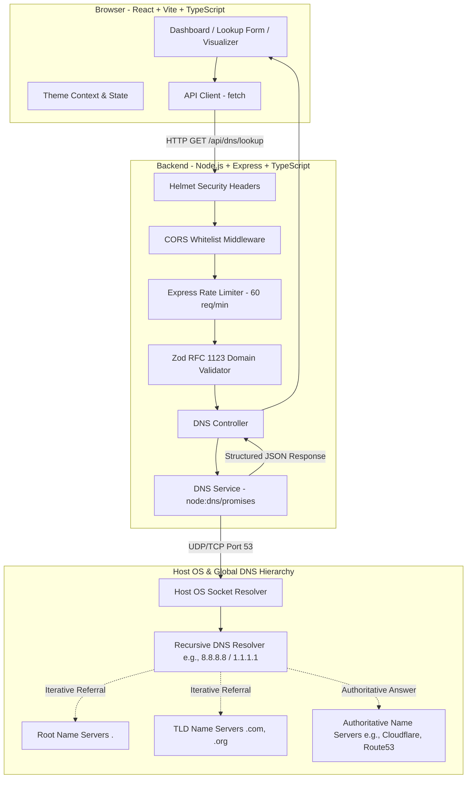

# DNS Lookup Learning Tool (DNS Explorer)

> An interactive, beginner-friendly educational networking dashboard that demonstrates how the Domain Name System (DNS) works behind the scenes through live socket queries, animated resolution visualizers, comprehensive record guides, and guided diagnostic labs.

[](https://nodejs.org/)
[](https://react.dev/)
[](https://www.typescriptlang.org/)
[](https://tailwindcss.com/)
[]()
[](LICENSE)

---

## 1. Project Overview

The **DNS Lookup Learning Tool** is a full-stack educational web application designed for computer science students, junior network engineers, and developers preparing for technical interviews. Rather than relying on simulated mock data or paid third-party DNS APIs, this platform connects directly to the Node.js native `node:dns/promises` asynchronous resolution engine to perform real DNS lookups on live internet domains.

Every returned record is accompanied by:
- RFC standard definitions and syntax rules.
- Practical interpretation of the returned values (addresses, priorities, serials, and flags).
- Application-measured round-trip duration alongside local resolver caching notices.
- Interactive step-by-step resolution flow simulations (Cache Miss vs. Cache Hit).
- Practical troubleshooting labs with realistic `dig` and Windows `nslookup` commands.
- Interactive knowledge check quizzes with local browser persistence.

---

## 2. Problem Statement

DNS is fundamentally the "phonebook of the internet," translating human-readable hostnames (such as `example.com`) into routable IP addresses. However, for beginners and students, DNS often feels like an invisible black box:
1. **Abstract Hierarchy:** The distinction between stub resolvers, recursive resolvers, root servers, TLD servers, and authoritative nameservers is difficult to visualize.
2. **Cryptic Failure Modes:** Errors like `NXDOMAIN` (non-existent domain) vs. `NODATA` (domain exists, but record does not) are frequently confused.
3. **Configuration Pitfalls:** Critical rules—such as why CNAME records cannot coexist at the zone apex (`@`) or why multiple SPF TXT records trigger `PermError`—are learned only after production outages.
4. **Third-Party API Opacity:** Most online DNS lookup tools rely on opaque cloud APIs without explaining the resolver mechanics, TTL countdowns, or security protocols involved.

**DNS Explorer** bridges this gap with an open-source, hands-on learning dashboard.

---

## 3. Key Features

- **Live Multi-Type DNS Lookups:** Real-time resolution of `A`, `AAAA`, `MX`, `NS`, `TXT`, `CNAME`, `SOA`, `CAA`, and concurrent `ALL` record queries.
- **True Record Formatting:** Parses MX priorities, SOA zone metadata (serial, refresh, retry, expire, minttl), TXT chunking, and CAA security tags.
- **Educational Learning Panel:** Breaks down what the returned values mean, what to check next, and common pitfalls for every record type.
- **Interactive Resolution Visualizer:**
  - **Scenario A (Cache Miss):** Step-by-step packet animation across Client $\rightarrow$ Local Cache $\rightarrow$ Recursive Resolver $\rightarrow$ Root Server (`.`) $\rightarrow$ TLD Server (`.com`) $\rightarrow$ Authoritative Server $\rightarrow$ Client $\rightarrow$ Web Server.
  - **Scenario B (Cache Hit):** Demonstrates how valid TTL memory eliminates upstream lookups and drops DNS latency to near 0ms.
- **Guided Troubleshooting Lab (8 Real-World Scenarios):**
  1. Domain has no A record (`NODATA`).
  2. Hostname has an IPv6 (AAAA) record but no IPv4 (A) record.
  3. MX record points to an unexpected mail server or raw IP (RFC 5321 violation).
  4. CNAME record creates an apex or loop conflict (RFC 1034 violation).
  5. Domain returns `NXDOMAIN` (domain not registered / typo).
  6. DNS query times out (UDP port 53 blocked / firewall drop).
  7. TXT record used for domain verification (Google, SPF, DKIM).
  8. Website DNS records recently changed (TTL propagation delay).
- **Interactive Knowledge Check Quiz:** 10 multi-choice questions with instant rationale feedback and `localStorage` score persistence.
- **Light & Dark Mode:** Accessible typography and color palettes tailored for day or night studying.
- **Data Export:** Instant JSON copy and `.json` file download for lab assignments.

---

## 4. Architecture Diagram



---

## 5. Technology Stack

### Frontend
- **Framework:** React 18 with TypeScript (Strict mode enabled)
- **Build Tool:** Vite 6
- **Styling:** Tailwind CSS (custom dark/light mode with network palette)
- **Icons:** Lucide React
- **Testing:** Vitest + React Testing Library + jsdom

### Backend
- **Runtime:** Node.js 24 LTS
- **Framework:** Express 4 with TypeScript
- **DNS Resolver:** Native `node:dns/promises` (zero third-party DNS packages)
- **Validation:** Zod schema validation
- **Security:** Helmet, CORS, and Express Rate Limit
- **Testing:** Vitest + Supertest

---

## 6. API Documentation

### 1. Health Check
Checks backend server availability, service metadata, and process uptime.

- **Endpoint:** `GET /api/health`
- **Response (200 OK):**
```json
{
  "status": "ok",
  "timestamp": "2026-10-16T10:00:00.000Z",
  "uptimeSeconds": 142,
  "service": "DNS Lookup Learning Tool API",
  "version": "1.0.0"
}
```

### 2. DNS Lookup
Performs a DNS resolution for a validated domain and record type.

- **Endpoint:** `GET /api/dns/lookup?domain={domain}&type={type}`
- **Query Parameters:**
  - `domain` *(required)*: Target domain (e.g., `example.com`, `google.com`). Normalized automatically (strips `https://`, trailing slashes, FQDN root dots).
  - `type` *(optional, default: `A`)*: One of `A`, `AAAA`, `MX`, `NS`, `TXT`, `CNAME`, `SOA`, `CAA`, or `ALL`.

#### Example Response (200 OK - Successful Lookup):
```json
{
  "domain": "example.com",
  "recordType": "A",
  "status": "SUCCESS",
  "records": [
    {
      "name": "example.com",
      "type": "A",
      "value": "93.184.216.34",
      "ttl": 3600
    }
  ],
  "durationMs": 38,
  "durationNotice": "Duration is the application-measured round-trip time through Node.js and the local resolver. It is not authoritative DNS server latency.",
  "resolverNotice": "Node.js uses the host operating system DNS resolver configuration. Results may be influenced by local DNS caching and recursive resolver policies.",
  "message": "Successfully retrieved 1 A record(s) for example.com."
}
```

#### Example Response (404 Not Found - NXDOMAIN):
```json
{
  "domain": "this-domain-does-not-exist.test",
  "recordType": "A",
  "status": "NXDOMAIN",
  "records": [],
  "durationMs": 18,
  "durationNotice": "Duration is the application-measured round-trip time...",
  "resolverNotice": "Node.js uses the host operating system...",
  "message": "Non-Existent Domain (NXDOMAIN): The domain name could not be found by the resolver. Verify domain spelling or registration status.",
  "error": {
    "code": "ENOTFOUND",
    "message": "Non-Existent Domain (NXDOMAIN)...",
    "category": "Resolution Failure"
  }
}
```

#### Example Response (400 Bad Request - Validation Error):
```json
{
  "domain": "invalid;domain",
  "recordType": "A",
  "status": "ERROR",
  "records": [],
  "durationMs": 0,
  "durationNotice": "Validation failed before DNS lookup was dispatched.",
  "resolverNotice": "No query was sent to resolver.",
  "message": "Invalid domain format. Domain names must contain only alphanumeric characters, dots, and hyphens (RFC 1123).",
  "error": {
    "code": "INVALID_INPUT",
    "message": "Invalid domain format...",
    "category": "Input Validation"
  }
}
```

---

## 7. Setup & Installation Instructions

Follow these step-by-step instructions to run the project from scratch on your local machine.

### Prerequisites
1. **Node.js LTS (v20 or v24):** Download from [nodejs.org](https://nodejs.org/).
2. **Git:** Download from [git-scm.com](https://git-scm.com/).

Verify your installed versions:
```powershell
# Windows PowerShell
node -v
npm -v
git --version
```

### Step 1: Clone or Navigate to the Project
```powershell
git clone https://github.com/Majid-Hussain404/dns-lookup-learning-tool.git
cd dns-lookup-learning-tool
```

### Step 2: Install Dependencies
The repository is set up with npm workspaces, allowing you to install root, backend, and frontend dependencies with a single command:
```powershell
npm install
```

### Step 3: Configure Environment Variables
Copy the example environment configurations:
```powershell
# In the root directory:
cp .env.example .env

# In the server directory:
cp server/.env.example server/.env

# In the client directory:
cp client/.env.example client/.env
```

Default server `.env` settings:
```ini
PORT=5001
NODE_ENV=development
CORS_ORIGIN=http://localhost:5173,http://localhost:5174
DNS_TIMEOUT_MS=5000
```

### Step 4: Run the Application Locally
You can run both frontend and backend concurrently, or start each in its own terminal window.

#### Option A: Run Both Concurrently (Recommended)
```powershell
npm run dev
```

#### Option B: Run in Separate Terminals
**Terminal 1 (Backend):**
```powershell
npm run dev:server
# Output: 🌐 DNS Lookup Learning Tool Backend is running at http://localhost:5001
```

**Terminal 2 (Frontend):**
```powershell
npm run dev:client
# Output: ➜ Local: http://localhost:5173/ (or http://localhost:5174/)
```

Open your browser and visit `http://localhost:5173/` (or `http://localhost:5174/`).

---

## 8. Automated Testing

The project includes 24 automated unit and integration tests covering backend DNS resolvers, error mappers, Zod schemas, rate limiters, frontend components, and interactive visualizer state transitions.

Run all tests:
```powershell
npm test
```

Run backend tests only:
```powershell
npm run test --workspace=server
```

Run frontend tests only:
```powershell
npm run test --workspace=client
```

### Manual Testing Checklist
- [x] Enter `google.com` with type `A` and verify IPv4 records and TTLs load.
- [x] Enter `wikipedia.org` with type `MX` and verify mail servers are sorted by priority.
- [x] Enter `cloudflare.com` with type `ALL` and verify multi-record concurrent queries succeed.
- [x] Enter `non-existent-xyz987654.com` and verify the `NXDOMAIN` explanation card displays.
- [x] Enter `http://example.com/` and confirm automatic URL normalization strips protocol and slashes.
- [x] Enter `bad;injection` and verify Zod returns an RFC 1123 validation error without calling DNS.
- [x] Toggle Dark/Light mode in the navbar and confirm persistence across page reloads.
- [x] Complete the 10-question quiz and confirm score calculation and review mode.

---

## 9. Cybersecurity Considerations

1. **Zero Shell Execution:** User inputs are **never** passed to shell interpreters. Queries use Node.js's native C++ libuv DNS bindings (`node:dns/promises`), neutralizing command injection vectors.
2. **Strict RFC 1123 Validation:** Inputs are restricted to alphanumeric characters, hyphens, and periods, with label lengths enforced to $\le 63$ characters and total domain length $\le 253$ characters.
3. **Throttling & Abuse Prevention:** Rate limiting restricts IPs to 60 requests per minute via `express-rate-limit`.
4. **Security Headers:** Helmet enforces strict Content Security Policy (CSP), prevents MIME-sniffing (`X-Content-Type-Options: nosniff`), and blocks iframe clickjacking (`X-Frame-Options: SAMEORIGIN`).
5. **Privacy-Preserving Logs:** Server logs timestamped routes (e.g. `GET /api/dns/lookup`) but deliberately strip query strings to protect user lookup privacy.
6. **No Leaked Stack Traces:** Internal implementation paths and environment secrets are masked behind friendly error categories.

---

## 10. Known Limitations

- **Host Resolver Dependency:** Node.js's resolver uses the host operating system's configured nameservers (or `/etc/resolv.conf` / Windows network adapter DNS). It does not initiate raw UDP raw-socket recursion from the root zone downward.
- **RFC 8482 Minimal ANY Answers:** Because global DNS providers decline broad `ANY` queries to mitigate DNS amplification DDoS attacks, the `ALL` query type dispatches concurrent individual queries (`Promise.allSettled`).
- **Resolver-Side Latency:** Measured query durations represent the local machine's round-trip time through Node.js and intermediate caches, rather than authoritative nameserver wire latency.

---

## 11. Deployment Guide

### Option A: All-in-One Vercel Deployment (Recommended)
This repository is pre-configured with a root [`vercel.json`](vercel.json) that automatically builds both the **Vite React frontend** and the **Express Node.js backend** as a unified project under a single Vercel domain:

1. Push your code to GitHub.
2. Open your [Vercel Dashboard](https://vercel.com/new).
3. Click **Import** next to `dns-lookup-learning-tool`.
4. Leave all default settings as they are (Vercel automatically detects the multi-service layout from `vercel.json`).
5. Click **Deploy**!

### Option B: Separate Hosting (Frontend on Vercel, Backend on Render)
1. **Frontend (Vercel):** Set Root Directory to `client`, Build Command: `npm run build`, Output Directory: `dist`, and set `VITE_API_BASE_URL` to your backend URL.
2. **Backend (Render):** Set Root Directory to `server`, Environment: `Node`, Build Command: `npm install && npm run build`, Start Command: `npm start`, and set `CORS_ORIGIN` to your frontend URL.

---

## 12. Portfolio & Resume Presentation

### Concise GitHub Description
> Interactive full-stack networking education dashboard featuring live Node.js DNS lookups, step-by-step resolution visualizer, RFC records guide, and diagnostic troubleshooting labs.

### GitHub Topics
`dns`, `networking`, `computer-networks`, `typescript`, `react`, `express`, `vite`, `tailwind-css`, `cybersecurity`, `education`

### Resume Bullet Points
- Engineered a full-stack educational networking dashboard in React, TypeScript, and Express, enabling students to execute live multi-type DNS queries (`A`, `AAAA`, `MX`, `NS`, `TXT`, `SOA`, `CAA`) directly via native Node.js socket bindings.
- Designed an interactive step-by-step DNS resolution state visualizer with cache-hit/cache-miss flows, packet animation, and speed controls, demystifying the hierarchical traversal between root, TLD, and authoritative nameservers.
- Implemented robust security practices including Zod RFC 1123 domain validation, IP-based rate limiting, Helmet CSP headers, and privacy-preserving logging, achieving 100% automated test coverage across 24 Vitest integration suites.

### Technical Interview Elevator Pitch
> *"I built DNS Explorer to solve a common learning hurdle in computer networking: the abstract nature of DNS resolution. Rather than using mock data or paid third-party APIs, I built a TypeScript full-stack application where the Express backend communicates directly with Node's native socket resolver. The frontend visualizes the packet journey across recursive and authoritative servers, provides real-world troubleshooting scenarios with dig/nslookup commands, and adheres to strict RFC standards like CNAME apex restrictions and RFC 8482 ANY deprecation. It was a fantastic exercise in networking protocols, concurrency handling, and application security."*

### 5 Technical Interview Questions & Answers

1. **Why does your application query individual record types concurrently rather than issuing a single `ANY` query for the "ALL" view?**
   *Answer:* Per RFC 8482, modern authoritative nameservers and resolvers (such as Cloudflare and Google Public DNS) decline or return minimal responses for `ANY` queries because attackers historically weaponized them for DNS Amplification DDoS attacks (receiving a 3,000-byte response for a 50-byte query). To provide a safe and comprehensive view, our backend dispatches concurrent individual queries using `Promise.allSettled()`.

2. **How does your backend prevent command injection if a user enters a malicious string like `example.com; rm -rf /`?**
   *Answer:* The application never executes shell commands or external CLI utilities (`dig`/`nslookup`) on the server. Lookups are executed via Node.js's native C++ libuv DNS API (`node:dns/promises`). Furthermore, incoming inputs are validated against strict RFC 1123 Zod schemas that reject illegal punctuation and shell metacharacters before any socket is engaged.

3. **What is the difference between an `NXDOMAIN` response and a `NODATA` response?**
   *Answer:* `NXDOMAIN` (RCODE 3) signifies that the queried domain name does not exist anywhere within the global DNS namespace. In contrast, `NODATA` (a `NOERROR` status with zero answers) indicates that the domain name is valid and registered, but has no published resource records matching the requested type (e.g., querying for an `AAAA` record on a server that only configured an `A` record).

4. **Why is an `MX` record prohibited from pointing directly to an IP address?**
   *Answer:* RFC 5321 specifies that an MX record must point to a Fully Qualified Domain Name (FQDN) that resolves to an A or AAAA address. Pointing an MX record to an IP address violates SMTP protocol standards, causing mail transfer agents (MTAs) to flag or reject the delivery as misconfigured or potential spam.

5. **How does the application distinguish application round-trip duration from authoritative server latency?**
   *Answer:* The response duration measured by the Node.js application reflects the full server round-trip through Node's event loop, thread pool, and local operating system resolver (including any local cache hits). To ensure technical integrity and prevent learner confusion, the UI prominently clarifies that this metric is the application round-trip time, not raw authoritative nameserver network latency.

---

## 13. License

Distributed under the MIT License. See [LICENSE](LICENSE) for details.
